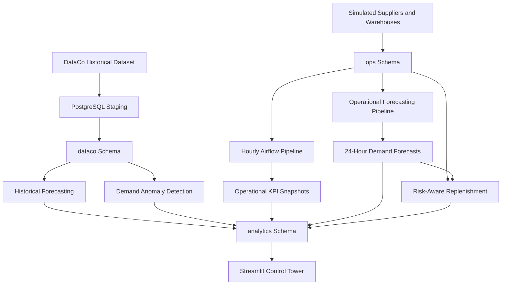
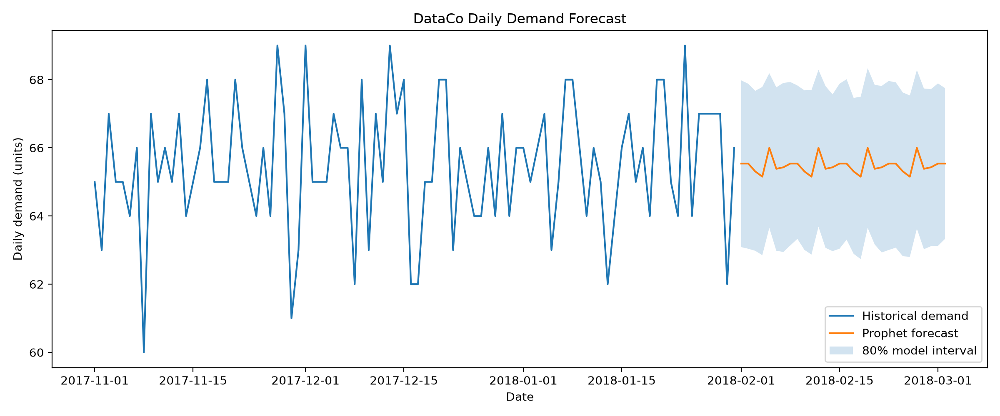

# NEXVIA — Retail & Supply Chain Control Tower

### End-to-End Supply Chain Analytics, Forecasting & Decision Support

**Tech Stack:** Python | PostgreSQL | Apache Airflow | Docker | Streamlit | SQLAlchemy | Prophet | Croston-SBA | Plotly

NEXVIA is an end-to-end supply chain analytics and decision-support project that combines historical retail transaction data, simulated operational inventory, automated data pipelines, demand forecasting, anomaly detection, and intelligent replenishment planning.

The platform demonstrates how data engineering, statistical forecasting, workflow orchestration, and interactive business intelligence can be integrated into a centralized **Supply Chain Control Tower**.

> **Project scope:** Historical retail data comes from the DataCo Smart Supply Chain dataset. Operational inventory, warehouse activity, supplier events, and replenishment scenarios are simulated. NEXVIA is an analytical prototype, not a production inventory management system.

---

## 1. Project Overview

Retail supply chains face several interconnected challenges:

- Limited visibility into inventory across warehouses
- Unexpected demand fluctuations
- Supplier lead-time variability
- Stockouts and inefficient inventory allocation
- Fragmented KPI reporting
- Difficulty comparing replenishment decisions under uncertainty

NEXVIA addresses these challenges through a centralized PostgreSQL data model, automated Airflow pipelines, statistical forecasting, and an interactive Streamlit dashboard.

### Key capabilities

- Historical retail supply chain analytics
- Simulated hourly inventory monitoring
- Supplier performance and reliability analysis
- Automated KPI generation and snapshots
- Historical and operational demand forecasting
- Demand-spike and supplier-delay anomaly detection
- Warehouse-level inventory risk assessment
- Supplier-delay scenario simulation
- Interwarehouse stock transfer recommendations
- Emergency procurement planning
- Interactive charts, filters, and CSV exports

### Project objectives

1. Integrate historical and operational supply chain information into PostgreSQL.
2. Automate simulated inventory processing and reporting using Apache Airflow.
3. Forecast demand using statistical and intermittent-demand models.
4. Identify inventory and supplier-related risks.
5. Compare replenishment decisions under supplier delays.
6. Present the results through an interactive decision-support dashboard.

---

## 2. Technology Stack

| Layer | Technology | Purpose |
|---|---|---|
| Programming | Python | Data engineering, analysis and forecasting |
| Database | PostgreSQL | Structured storage and analytical SQL |
| Data processing | Pandas, NumPy | Data manipulation and evaluation |
| Database connectivity | SQLAlchemy, Psycopg2 | Python–PostgreSQL integration |
| Workflow orchestration | Apache Airflow | Scheduled data pipelines |
| Containerization | Docker | Local Airflow execution environment |
| Forecasting | Prophet | Historical aggregate demand forecasting |
| Intermittent demand | Croston-SBA | Sparse product-demand forecasting |
| Baseline forecasting | Statistical averages | Operational demand prediction and benchmarking |
| Dashboard | Streamlit | Interactive application |
| Visualization | Plotly, Matplotlib | Forecast and KPI visualization |
| Version control | Git, GitHub | Source management and documentation |

---

## 3. System Architecture

NEXVIA uses separate historical and simulated operational layers to prevent confusion between observed historical transactions and generated operational activity.



### Database architecture

| Schema | Responsibility |
|---|---|
| `dataco` | Historical customer orders, order items and product information |
| `ops` | Simulated suppliers, warehouses, inventory ledger, hourly inventory and KPIs |
| `analytics` | Forecasts, anomalies, replenishment analysis and decision-support views |

### Data separation

**Historical layer:** Uses the DataCo dataset, with forecasting experiments based primarily on historical observations through January 2018.

**Operational layer:** Uses a separately generated November 2026 inventory simulation.

**Important:** Simulated inventory is not presented as real live enterprise data, and operational forecasts are not trained directly on the historical 2018 forecast outputs.

---

## 4. Data Engineering and PostgreSQL

The DataCo Smart Supply Chain dataset is imported into PostgreSQL for downstream analytics.

### Historical source data

The project uses normalized historical tables including:

- `dataco.customer_orders`
- `dataco.order_items`
- `dataco.products`

The established database contains 180,519 historical order-item records.

The import process:

1. Reads the DataCo CSV archive.
2. Excludes selected sensitive customer fields.
3. Standardizes column names.
4. Parses date and timestamp columns.
5. Loads records into a staging table.
6. Supports subsequent normalization into analytical tables.

The importer does not independently recreate every downstream schema, table, function, or view.

### Operational simulation

The operational layer includes simulated:

- Product–warehouse inventory positions
- Supplier assignments and lead times
- Purchase orders and inbound receipts
- Customer demand and inventory consumption
- Hourly inventory snapshots
- Operational KPI records

The operational environment covers 118 products across three warehouses, producing 354 product–warehouse combinations.

The central inventory simulation function is:

`ops.advance_simulated_hour()`

It advances the simulated operational clock and updates warehouse inventory activity.

Duplicate-processing safeguards are used to prevent repeated execution of the same simulated hour.

---

## 5. Apache Airflow Automation

NEXVIA contains two Airflow pipelines.

### 5.1 Hourly Supply Chain Pipeline

**DAG ID:** `hourly_supply_chain_pipeline`

**Schedule:** `@hourly`

**Timezone:** `Asia/Kolkata`

**Purpose:** Automate operational inventory processing, KPI generation and anomaly monitoring.

The pipeline contains six tasks:

| Order | Task | Responsibility |
|---|---|---|
| 1 | `check_source_data` | Validate required historical and operational data |
| 2 | `advance_inventory_simulation` | Advance the simulated inventory hour |
| 3 | `save_operational_kpis` | Persist hourly operational KPI data |
| 4 | `monitor_anomalies` | Validate and monitor anomaly records |
| 5 | `refresh_kpi_snapshot` | Refresh the KPI overview snapshot |
| 6 | `verify_refresh` | Verify completeness of the refresh |

### 5.2 Operational Demand Forecasting Pipeline

**DAG ID:** `operational_demand_forecast_pipeline`

**Schedule:** `15 * * * *`

**Purpose:** Generate and persist operational demand forecasts.

The pipeline contains three tasks:

| Order | Task | Responsibility |
|---|---|---|
| 1 | `check_operational_history` | Validate available demand history |
| 2 | `generate_operational_forecasts` | Generate product-level forecasts |
| 3 | `verify_operational_forecasts` | Verify generated forecast records |

The operational forecasting pipeline produces a 24-hour prediction horizon for 118 products.

### Pipeline validation

Both DAGs have been executed successfully in the local Airflow environment.

Database-level checks have also verified forecast completeness, synchronized inventory and forecast timestamps, and zero missing KPI snapshots for the evaluated simulation snapshot.

**Current limitation:** The DAGs use separate schedules. The 15-minute offset is not an enforced dependency, so successful scheduling does not guarantee that forecasting always starts after inventory processing completes.

---

## 6. Demand Forecasting

NEXVIA implements historical and operational demand forecasting as separate analytical workflows.

### 6.1 Historical Aggregate Forecasting

Historical DataCo demand is aggregated at the daily level and evaluated using Prophet.

The workflow includes:

- Daily demand aggregation
- Historical training and testing
- Prophet forecasting
- Naive baseline comparison
- Error evaluation
- Thirty-day forecast generation

Evaluation metrics include:

**Mean Absolute Error (MAE)**

\[
MAE = \frac{1}{n}\sum_{i=1}^{n}|y_i-\hat{y}_i|
\]

**Weighted Absolute Percentage Error (WAPE)**

\[
WAPE = \frac{\sum|y_i-\hat{y}_i|}{\sum|y_i|}\times100
\]

In one recorded historical evaluation, Prophet achieved approximately 1.603 MAE and 2.44% WAPE, while the naive baseline achieved approximately 1.529 MAE.

Therefore, the evaluated Prophet model did not outperform the naive benchmark on MAE.

### Historical forecast visualization



### 6.2 Product-Level Intermittent Demand Forecasting

The historical dataset contains many products with infrequent or zero observed demand.

The project evaluates:

- Croston-SBA
- Zero-demand baseline
- Historical average
- Recent-demand average

The recorded historical product forecasting workflow includes:

| Metric | Result |
|---|---:|
| Products evaluated | 118 |
| Products with training-period demand | 18 |
| Products without training-period demand | 100 |
| Forecast horizon | 30 days |
| Product-level forecast records | 3,540 |

The zero-demand baseline can produce low numerical error in sparse datasets while failing to anticipate real demand.

Consequently, numerical accuracy alone is insufficient for selecting a replenishment forecasting model.

### 6.3 Operational Hourly Forecasting

Operational demand forecasting is based on simulated hourly demand history.

**Model:** `HOURLY_MEAN_BASELINE_V1`

**Data source:** `SIMULATED_HOURLY`

| Forecast property | Value |
|---|---:|
| Products | 118 |
| Forecast horizon | 24 hours |
| Forecast records per complete cutoff | 2,832 |
| Forecast frequency | Hourly |
| Output table | `analytics.operational_demand_forecasts` |

The baseline calculates average historical hourly demand per product and applies it over the next 24 simulated hours.

This provides a transparent forecasting approach that can be evaluated and compared with more sophisticated methods.

### 6.4 Operational Model Evaluation

Four approaches were compared during simulated operational backtesting:

- Last-hour naive
- Full-history hourly mean
- Recent 24-hour mean
- Zero baseline

Evaluation considered forecast error as well as asymmetric business penalties for underforecasting versus overforecasting.

A three-fold rolling-origin comparison favored the full-history mean in two of three tested folds under the selected hypothetical cost penalty.

The full-history mean remains a provisional operational baseline, not a proven globally optimal forecasting model.

---

## 7. Anomaly Detection

The system combines historical demand anomaly detection with simulated supplier-delay monitoring.

### 7.1 Demand Spike Detection

Demand spikes are identified using product-level rolling historical baselines.

The detection logic examines:

- Rolling demand mean
- Rolling standard deviation
- Z-score
- Minimum demand threshold
- Previous positive-demand activity

The resulting anomaly records are stored in:

`analytics.demand_spike_anomalies`

### 7.2 Supplier Delay Detection

Supplier delivery delays are classified into severity categories.

| Delay | Severity |
|---|---|
| Two days late | WARNING |
| Three or more days late | CRITICAL |

Supplier anomalies are exposed through:

`analytics.v_supplier_delay_anomalies`

Combined anomalies are accessible through:

`analytics.v_control_tower_anomalies`

The dashboard provides anomaly counts, trend visualizations, filtering, and CSV export.

---

## 8. Risk-Aware Replenishment

The replenishment module models inventory shortage risk when supplier deliveries experience additional delays.

It incorporates:

- Product-level projected demand
- Available warehouse stock
- Supplier lead time
- Additional delivery delay
- Stock availability at other warehouses
- Interwarehouse transfer allocation
- Residual emergency procurement needs

### 8.1 Supplier Delay Scenarios

The model evaluates alternative supplier-delay scenarios.

Validated results from one synchronized simulated snapshot:

| Additional supplier delay | Locations at risk | Projected shortage | Transferable units | Emergency procurement |
|---|---:|---:|---:|---:|
| +14 days | 2 | 14 | 14 | 0 |
| +30 days | 4 | 84 | 9 | 75 |

These results satisfy:

\[
\text{Projected shortage}=
\text{Transfer units}+\text{Emergency units}
\]

The validated queries reported zero allocation arithmetic errors.

### 8.2 Warehouse Transfer Planning

The replenishment engine identifies potential donor warehouses with available stock and allocates units to locations facing shortages.

The objective is to use available interwarehouse inventory before recommending additional emergency procurement.

Transfer recommendations include:

- Product information
- Destination warehouse
- Source warehouse information
- Recommended transfer quantity

The modeled transfers are recommendations; they are not executed automatically.

### 8.3 Emergency Procurement

When warehouse transfers cannot cover a projected shortage, the remaining requirement is classified as potential emergency procurement.

For the validated additional 30-day delay scenario:

- Total shortage: 84 units
- Potential transfers: 9 units
- Remaining emergency requirement: 75 units

### 8.4 Replenishment Decision View

Recommendations are generated through:

`analytics.v_operational_replenishment_actions`

This PostgreSQL view supports the Risk-Aware Replenishment dashboard tab and downloadable action reports.

### Planning assumptions and limitations

The allocation does not independently verify:

- Interwarehouse transport duration
- Vehicle or transfer capacity
- Real supplier stock availability
- Actual delivery commitments
- Real procurement quotations
- Operational execution feasibility

The output is a simulated decision-support scenario and must not be interpreted as a guaranteed shortage reduction.

---

## 9. Streamlit Control Tower Dashboard

The interactive application is implemented in:

`dashboards/app.py`

The dashboard contains six tabs.

### Tab 1 — Historical Replenishment

Features:

- Historical supply chain KPI overview
- Product-level stockout risk
- Inventory policy comparisons
- Recommended order quantities
- Simulated emergency replenishment analysis

### Tab 2 — Hourly Inventory

Features:

- Hourly inventory trends
- Opening and closing stock
- Demand and fulfillment
- Unmet demand
- Stockout and fulfillment rates
- Projected days of inventory

### Tab 3 — Supplier Performance

Features:

- Supplier on-time delivery performance
- Expected versus actual lead time
- Average delivery delay
- Supplier reliability ranking
- Detailed supplier records

### Tab 4 — Anomaly Detection

Features:

- Demand-spike summaries
- Supplier-delay alerts
- Critical and warning counts
- Monthly anomaly trends
- Interactive anomaly explorer
- CSV export

### Tab 5 — Demand Forecasting

Features:

- Aggregate Prophet forecasts
- Historical product-level forecasts
- Model evaluation comparisons
- Historical backtest results
- Operational 24-hour forecasts
- Product-level forecast selection
- CSV export

### Tab 6 — Risk-Aware Replenishment

Features:

- Additional supplier-delay scenario selection
- Locations-at-risk KPIs
- Projected shortage metrics
- Interwarehouse transfer recommendations
- Emergency procurement estimates
- Product-level risk summaries
- Action-plan CSV export

The dashboard reads the results from PostgreSQL and uses separate historical and simulated operational data sources.

---

## 10. Project Directory Structure

```text
supply-chain-control-tower/
│
├── airflow/
│   └── dags/
│       ├── hourly_supply_chain.py
│       ├── operational_demand_forecast.py
│       └── test_postgres_connection.py
│
├── dashboards/
│   ├── app.py
│   ├── active_product_model_comparison.csv
│   ├── product_backtest_daily_predictions.csv
│   ├── product_backtest_metrics.csv
│   ├── product_model_comparison.csv
│   ├── prophet_forecast.png
│   ├── prophet_forecast_v2.png
│   └── prophet_forecast_v3.png
│
├── scripts/
│   ├── backtest_prophet_v3.py
│   ├── detect_demand_spikes.py
│   ├── forecast_demand.py
│   ├── forecast_product_demand.py
│   └── import_dataco.py
│
├── .editorconfig
├── .gitignore
├── requirements.txt
└── README.md
```

**Excluded local files:** The local Airflow Docker Compose configuration, Airflow runtime settings, environment files, virtual environment, source dataset archive, and backup files are intentionally excluded from Git.

---

## 11. Installation and Local Setup

### Prerequisites

- Python 3.13 or a compatible Python version
- PostgreSQL
- Docker Desktop for local Airflow
- Git
- Windows PowerShell or an equivalent terminal

### Step 1 — Clone the repository

```bash
git clone <REPOSITORY_URL>
cd supply-chain-control-tower
```

Replace `<REPOSITORY_URL>` with the actual GitHub repository URL after publication.

### Step 2 — Create a virtual environment

On Windows:

```powershell
py -3.13 -m venv .venv
.\.venv\Scripts\Activate.ps1
```

### Step 3 — Install Python dependencies

```powershell
python -m pip install -r requirements.txt
```

Validate the installed environment:

```powershell
python -m pip check
```

The current requirements file lists direct project dependencies without pinned versions.

### Step 4 — Prepare PostgreSQL

Create a local PostgreSQL database named:

`supply_chain_db`

The application expects the existing historical, operational, and analytics schemas.

**Important reproducibility limitation:** The repository does not yet contain version-controlled SQL migrations or a complete database initialization and seed process.

Therefore, cloning this repository alone does not recreate the full NEXVIA database or its analytical views.

### Step 5 — Import historical data

The historical importer expects the DataCo dataset archive at:

`data/archive.zip`

Run:

```powershell
python scripts/import_dataco.py
```

The source archive is not distributed with this repository.

The importer loads staging data; the full normalized database model must be provisioned separately.

### Step 6 — Historical analytics and forecasting

Once the required PostgreSQL objects exist, the scripts can be run individually:

```powershell
python scripts/forecast_demand.py
python scripts/backtest_prophet_v3.py
python scripts/detect_demand_spikes.py
python scripts/forecast_product_demand.py
```

These commands expect the corresponding source and output database structures to be available.

### Step 7 — Start Streamlit

From the project root:

```powershell
python -m streamlit run dashboards/app.py
```

Open:

`http://localhost:8501`

Enter the PostgreSQL password in the dashboard sidebar.

The password input is configured to conceal the characters while typing.

### Step 8 — Run Airflow

Airflow operates inside a local Docker environment.

For an already configured local installation with a valid Docker Compose file:

```powershell
cd airflow
docker compose up -d
docker compose ps
```

Open:

`http://localhost:8080`

Configure the Airflow connection:

`supply_chain_postgres`

Then enable the required DAGs.

**Deployment limitation:** The working local Compose file is intentionally excluded from the repository. A sanitized, reproducible Compose example and corresponding environment template still need to be added for independent setup on another machine.

---

## 12. Validation and Testing

The project includes several verified analytical and operational checks.

### 12.1 Operational Forecast Completeness

| Check | Validated result |
|---|---|
| Simulated inventory hours | 106 |
| Forecasted products | 118 |
| Forecast horizon | 24 hours |
| Forecast records | 2,832 |
| Missing KPI snapshots | 0 |
| Inventory/forecast synchronization | PASSED |

These results refer to an evaluated simulation snapshot, not continuously guaranteed values.

### 12.2 Replenishment Integrity

| Check | +14-day delay | +30-day delay |
|---|---|---|
| Locations at risk | 2 | 4 |
| Original shortage | 14 | 84 |
| Recommended transfers | 14 | 9 |
| Emergency procurement | 0 | 75 |
| Allocation calculation errors | 0 | 0 |
| Arithmetic validation | PASSED | PASSED |

### 12.3 Application and Pipeline Checks

The following checks have been performed during development:

- Python syntax compilation
- Airflow DAG execution checks
- PostgreSQL source-data validation
- Operational KPI completeness checks
- Inventory and forecast timestamp comparison
- Forecast record-count checks
- Replenishment allocation arithmetic validation
- Streamlit dashboard rendering
- Git ignore-rule verification
- Preliminary source-code credential scanning

These checks establish working functionality for the evaluated local environment. They do not substitute for automated integration tests, production monitoring, or deployment certification.

---

## 13. Security and Configuration

The repository uses `.gitignore` rules to exclude local and potentially sensitive files.

Examples include:

- Python virtual environments
- `.env` files
- Streamlit secret configuration
- Airflow runtime configuration
- Local Docker Compose configuration
- Database backups
- Raw source datasets

Database credentials must not be committed to the repository.

The local dashboard currently accepts the PostgreSQL password through a concealed sidebar input.

A preliminary credential scan found no obvious hardcoded password pattern in the files checked. This scan does not guarantee that all secrets are absent.

Before deploying the project outside a local development environment, review database permissions, secrets management, Airflow authentication, and network exposure.

---

## 14. Project Results and Key Learnings

The project demonstrates several important engineering and analytical concepts.

### Data Engineering

PostgreSQL provides a structured way to separate historical source records, simulated operations, and analytical results.

### Workflow Automation

Apache Airflow enables repeatable execution of inventory simulations, KPI generation, and forecasting tasks.

### Forecasting

Sparse demand requires appropriate benchmark comparisons. A model with lower average error may still perform poorly when stockouts have greater business consequences.

### Inventory Planning

Warehouse-level analysis provides more actionable information than aggregated inventory totals alone.

### Risk-Aware Replenishment

Potential warehouse transfers can reduce the amount of emergency procurement required in simulated supplier-delay scenarios.

### Business Intelligence

An interactive dashboard connects engineering outputs with interpretable operational metrics and decision-support views.

---

## 15. Limitations

This project has several known limitations.

1. Operational inventory and supplier events are simulated rather than obtained from live enterprise feeds.
2. Complete SQL migrations and database seed scripts are not currently version-controlled.
3. The local Airflow Docker Compose configuration is not included in the public repository.
4. The two Airflow DAGs do not yet have an explicit cross-DAG dependency.
5. Forecast accuracy is evaluated on limited and sparse demand histories.
6. Inventory transfer recommendations do not model physical transportation constraints.
7. Emergency procurement assumptions do not represent confirmed supplier quotations.
8. Automated unit tests and independent integration tests remain to be implemented.
9. Reproducible deployment requires additional configuration templates and version pinning.

---

## 16. Future Improvements

Potential future development includes:

- Real-time inventory and order-system integration
- Automated database schema migrations
- Reproducible Docker and environment templates
- Explicit Airflow dataset-based pipeline dependencies
- Improved probabilistic demand forecasts
- Additional intermittent-demand forecasting models
- Lead-time uncertainty and safety-stock optimization
- Warehouse routing and transfer-time constraints
- Automated data-quality and regression testing
- Alert notifications and monitoring
- Deployment to a secured server or cloud environment

---

## 17. Project Purpose

NEXVIA was developed as a technical portfolio and academic project to demonstrate practical skills in:

- SQL and relational database design
- Python data processing
- Workflow orchestration
- Data pipeline validation
- Demand forecasting and model evaluation
- Supply chain analytics
- Inventory risk modeling
- Dashboard development
- Decision-support system design

It illustrates how multiple data and analytics technologies can be combined to create an integrated supply chain control tower.

---

## Author

**Anand Kumar Pandit**

**Indian Institute of Technology Patna**

**Project:** NEXVIA — Retail & Supply Chain Control Tower

---

*Built for educational, analytical, and portfolio demonstration. Operational scenarios are simulated and recommendations require real-world validation before deployment.*