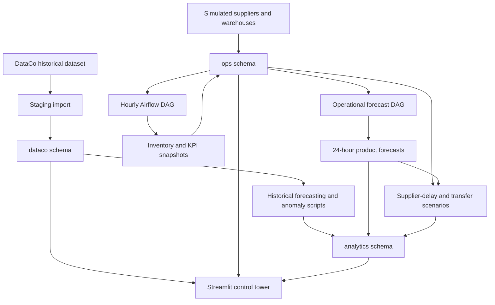
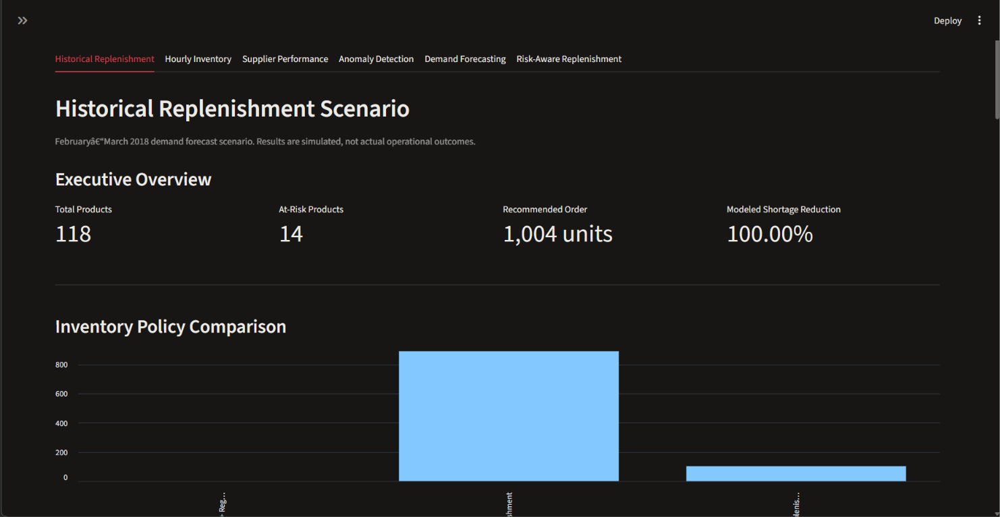
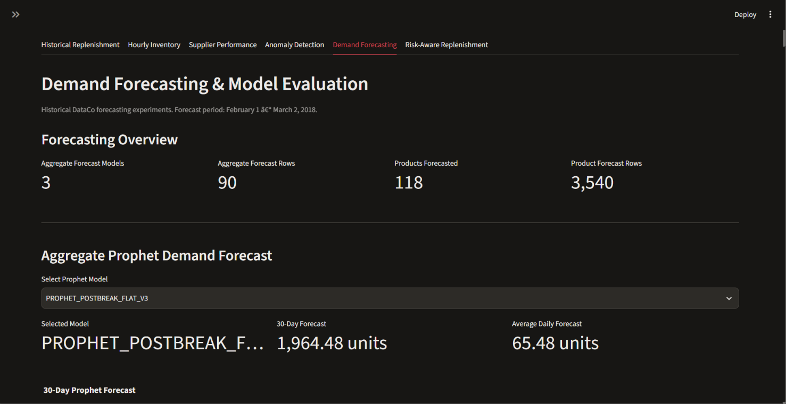
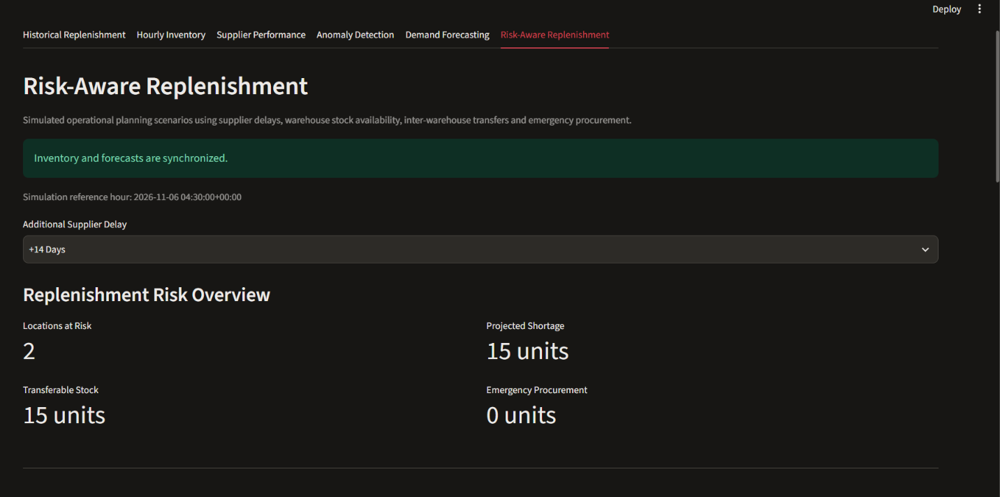
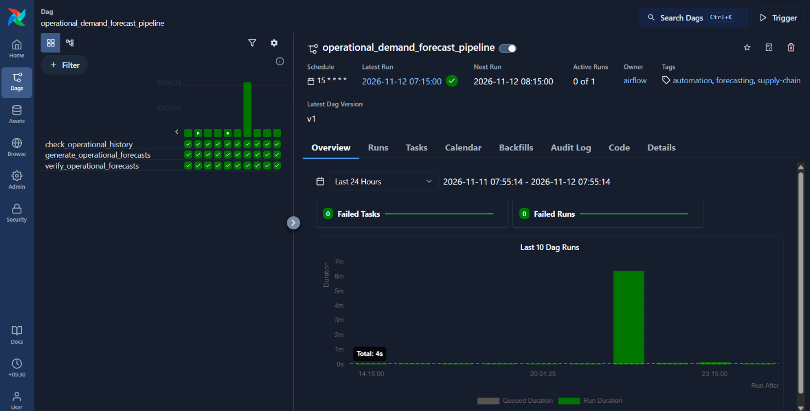
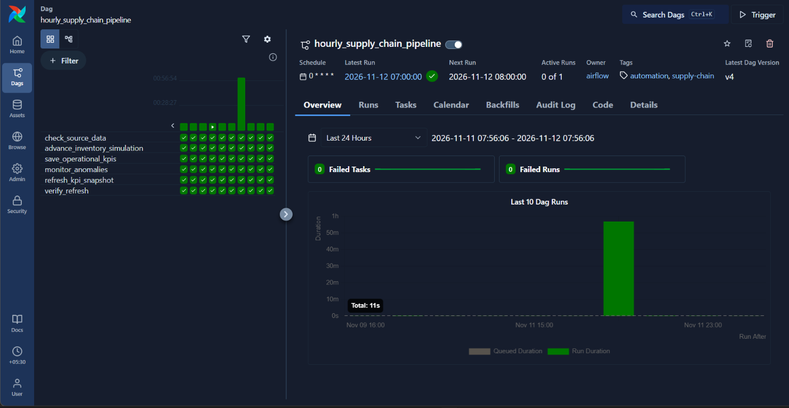

# NEXVIA — Retail & Supply Chain Control Tower

### End-to-End Supply Chain Analytics, Forecasting & Decision Support

**Tech stack:** Python · PostgreSQL · Apache Airflow · Docker · Streamlit · SQLAlchemy · Prophet · Croston-SBA · Plotly

NEXVIA is a supply chain analytics and decision-support project combining historical retail transactions with **separately simulated operations**. It brings inventory monitoring, supplier performance, demand forecasting, anomaly detection, and replenishment planning into a six-tab interactive control tower.

> **Data transparency:** Historical records come from the DataCo Smart Supply Chain dataset. Warehouse inventory, supplier events, and operational activity in November 2026 are **simulated**, not live enterprise feeds. Forecasts, transfers, and procurement quantities are analytical recommendations, not executed business transactions.

**Repository:** [github.com/anandpdt/supply-chain-control-tower](https://github.com/anandpdt/supply-chain-control-tower)

---

## 1. Project overview

Retail supply chains face challenges around stock visibility, demand variation, supplier lead-time uncertainty, stockouts, and fragmented reporting. NEXVIA demonstrates how to address these questions through a PostgreSQL data model, Python forecasting, scheduled Airflow workflows, and a Streamlit dashboard.

**Capabilities**

- Analyze historical retail orders, product demand, and replenishment scenarios.
- Monitor simulated hourly inventory, demand, fulfillment, and stockout rates.
- Evaluate simulated supplier reliability and delivery delays.
- Persist and validate operational KPI snapshots through scheduled workflows.
- Generate aggregate, intermittent-demand, and operational hourly forecasts.
- Detect historical demand spikes and simulated supplier-delay anomalies.
- Estimate warehouse-level shortages under additional supplier delays.
- Recommend theoretical interwarehouse transfers and residual emergency procurement.
- Explore metrics, charts, tables, filters, and downloadable CSV reports.

## 2. Technology stack

| Layer | Technology | Role |
|---|---|---|
| Language | Python | Data processing, simulation integration, forecasting |
| Database | PostgreSQL | Historical, operational, and analytical objects |
| Data tools | Pandas, NumPy, SQLAlchemy, Psycopg2 | Analysis and database access |
| Orchestration | Apache Airflow 3.3.2 | Hourly inventory and forecasting pipelines |
| Local infrastructure | Docker Compose, PostgreSQL 16, Redis 7.2 | Airflow services and metadata storage |
| Historical forecasting | Prophet, Croston-SBA, statistical baselines | Demand estimates and model comparisons |
| Application | Streamlit | Interactive control tower |
| Charts | Plotly, Matplotlib, Streamlit charts | Forecasts and business metrics |
| Version control | Git / GitHub | Source and project history |

The project data database was developed using a local PostgreSQL installation; the **PostgreSQL 16 container is for Airflow metadata** and is not itself the NEXVIA `supply_chain_db`.

## 3. System architecture



### Database separation

| Schema | Contents |
|---|---|
| `dataco` | Normalized historical orders, order items, and products |
| `ops` | Simulated suppliers, warehouses, inventory, receipts, and KPI views |
| `analytics` | Historical and operational forecasts, anomalies, and replenishment views |

**Historical experiments** use DataCo observations primarily through January 2018. **Operational experiments** advance a separate simulated clock beginning in November 2026. The two timelines must not be interpreted as a continuous live record.

## 4. Data engineering and PostgreSQL

The import workflow in `scripts/import_dataco.py` reads the DataCo archive from `data/archive.zip`, excludes selected sensitive customer fields, standardizes columns and timestamps, and loads a staging table. It does **not** independently normalize all historical tables or initialize the simulated operational dataset.

The established development database contains **180,519 historical order-item records** and **118 products**. The simulation uses **three warehouses**, for **354 product–warehouse combinations**.

The key simulation function, `ops.advance_simulated_hour()`, advances an hour of operational activity. The hourly DAG performs validation and records KPIs; duplicate-processing safeguards support repeatable execution.

### Versioned schema export

The repository now includes [`sql/schema.sql`](sql/schema.sql), generated with `pg_dump --schema-only` and successfully restored into a separate test database using PostgreSQL 18.

The verified restore created:

| Object | Count |
|---|---:|
| Schemas (`dataco`, `ops`, `analytics`) | 3 |
| Base tables | 20 |
| Regular views | 19 |
| Materialized views | 1 |
| Functions | 1 |

**Schema-only does not mean fully seeded.** This file defines structures but does not supply historical rows, warehouse inventory, suppliers, or analytical results. The staging import and normalized/operational population procedures require additional setup. A clean clone is therefore **not yet end-to-end runnable** with representative data.

## 5. Airflow automation

### 5.1 Hourly supply chain pipeline

- **DAG ID:** `hourly_supply_chain_pipeline`
- **Schedule:** `@hourly`
- **Timezone:** `Asia/Kolkata`
- **File:** `airflow/dags/hourly_supply_chain.py`

| Order | Task | Purpose |
|---:|---|---|
| 1 | `check_source_data` | Validate source and inventory-ledger records |
| 2 | `advance_inventory_simulation` | Process the next simulated hour |
| 3 | `save_operational_kpis` | Persist operational KPI snapshots |
| 4 | `monitor_anomalies` | Validate anomaly records and monitor counts |
| 5 | `refresh_kpi_snapshot` | Refresh aggregate KPI snapshot |
| 6 | `verify_refresh` | Confirm the expected refresh occurred |

### 5.2 Operational demand forecasting pipeline

- **DAG ID:** `operational_demand_forecast_pipeline`
- **Schedule:** `15 * * * *` (15 minutes after each hour)
- **File:** `airflow/dags/operational_demand_forecast.py`

| Order | Task | Purpose |
|---:|---|---|
| 1 | `check_operational_history` | Check historical simulated hourly demand |
| 2 | `generate_operational_forecasts` | Generate product-level hourly predictions |
| 3 | `verify_operational_forecasts` | Validate persisted forecast records |

Both DAGs have executed successfully in the developer's local environment. At a validated cutoff, the forecasting pipeline produced **2,832 rows** = **118 products × 24 forecast hours**, with synchronized inventory/forecast timestamps and **zero missing KPI snapshots**.

> **Scheduling limitation:** The independent cron schedules do not enforce that inventory processing finishes before forecasting starts. An explicit cross-DAG dependency or freshness gate is recommended before production use.

## 6. Demand forecasting and model evaluation

### Historical aggregate forecasting

`scripts/forecast_demand.py` uses Prophet to forecast aggregate daily DataCo demand over a 30-day horizon. Evaluations use MAE and WAPE and compare Prophet against a naive baseline.

\[
\mathrm{MAE}=\frac{1}{n}\sum_{i=1}^{n}|y_i-\hat{y}_i|
\]

\[
\mathrm{WAPE}=\frac{\sum_i|y_i-\hat{y}_i|}{\sum_i|y_i|}\times 100\%
\]

A recorded historical holdout produced approximately **Prophet MAE 1.603, WAPE 2.44%**, versus **naive MAE 1.529**. On MAE, Prophet **did not beat** the naive baseline in that test.


### Historical product-level intermittent demand

`scripts/forecast_product_demand.py` evaluates **Croston-SBA**, a zero baseline, and historical/recent averages. The observed historical training interval is sparse:

| Measure | Recorded value |
|---|---:|
| Products | 118 |
| Products with training demand | 18 |
| Products with no training demand | 100 |
| Historical forecast horizon | 30 days |
| Saved product forecast records | 3,540 |

A zero baseline can score well on sparse product-day averages while missing every actual unit sold on some test periods. Model selection therefore also considers shortage penalties and business consequences, not MAE alone.

### Operational hourly forecasting

- **Model:** `HOURLY_MEAN_BASELINE_V1`
- **Source:** `SIMULATED_HOURLY`
- **Output:** `analytics.operational_demand_forecasts`
- **Horizon:** 24 simulated hours per product

An operational rolling-origin comparison evaluated the last-hour naive, full-history hourly mean, recent 24-hour mean, and zero baseline. Under a selected illustrative penalty for underforecasting, **full-history mean performed best in two of three folds**. It is a provisional baseline—not an optimal or production-validated forecasting method.

## 7. Anomaly detection

- **Demand spikes:** Product-level rolling baselines using demand thresholds and z-scores. Outputs are written to `analytics.demand_spike_anomalies`.
- **Supplier delays:** Simulated delays surfaced through `analytics.v_supplier_delay_anomalies`; **WARNING** at two days late and **CRITICAL** at three or more days late.
- **Combined monitoring:** `analytics.v_control_tower_anomalies` feeds dashboard views and hourly anomaly counts.

Historical demand anomalies and simulated supplier delays are not current live operational alerts.

## 8. Risk-aware replenishment

The replenishment model uses current simulated warehouse inventory, hourly demand estimates, supplier lead times, additional delay scenarios, and potential donor-warehouse stock to calculate:

1. Original projected shortage at each affected product–warehouse location.
2. Units theoretically available through interwarehouse transfers.
3. Remaining units requiring potential emergency procurement.

The application reads recommendations from `analytics.v_operational_replenishment_actions`.

### Validated scenario snapshot

| Additional supplier delay | Locations at risk | Original shortage | Transfer units | Emergency units |
|---|---:|---:|---:|---:|
| +14 days | 2 | 14 | 14 | 0 |
| +30 days | 4 | 84 | 9 | 75 |

For both evaluated scenarios, the database integrity checks verified:

\[
\text{Original shortage}=\text{Recommended transfers}+\text{Emergency procurement}
\]

These are **alternative simulated scenarios**, not concurrent transactions. Real transport times, transfer capacity, supplier inventory, delivery promises, and actual purchasing costs are not incorporated or independently validated.

## 9. Interactive Streamlit dashboard

The six-tab application is in [`dashboards/app.py`](dashboards/app.py).

| Tab | Functionality |
|---|---|
| **Historical Replenishment** | Historical KPIs, stockout risk, order policies, emergency scenarios |
| **Hourly Inventory** | Stock, receipts, demand, fulfillment, stockout rates, inventory days |
| **Supplier Performance** | On-time delivery, lead times, supplier reliability |
| **Anomaly Detection** | Demand spikes, supplier alerts, severity filters, downloads |
| **Demand Forecasting** | Prophet forecasts, product-level evaluation, 24-hour operational forecasts |
| **Risk-Aware Replenishment** | Delay scenarios, shortage mitigation, transfers, emergency purchase estimates |

The dashboard supports interactive selectors, tabular drill-downs, charts and CSV exports. A PostgreSQL password is entered through a concealed Streamlit sidebar field; credentials are not intended to be stored in the repository.

## 10. Repository structure

```text
supply-chain-control-tower/
├── airflow/
│   ├── dags/
│   │   ├── hourly_supply_chain.py
│   │   ├── operational_demand_forecast.py
│   │   └── test_postgres_connection.py
│   ├── docker-compose.example.yaml
│   └── .env.example
├── dashboards/
│   ├── app.py
│   ├── active_product_model_comparison.csv
│   ├── product_backtest_daily_predictions.csv
│   ├── product_backtest_metrics.csv
│   ├── product_model_comparison.csv
│   └── prophet_forecast*.png
├── scripts/
│   ├── backtest_prophet_v3.py
│   ├── detect_demand_spikes.py
│   ├── forecast_demand.py
│   ├── forecast_product_demand.py
│   └── import_dataco.py
├── sql/
│   └── schema.sql
├── .editorconfig
├── .gitignore
├── requirements.txt
└── README.md
```

The tree shows the **intended committed structure** after the Airflow example files are pushed. Local secrets, runtime logs, data archives, virtual environments, and the real `airflow/docker-compose.yaml` are excluded from Git.

## 11. Local setup

### Prerequisites

- Git and Python 3.13 (or another version compatible with the listed packages)
- PostgreSQL, with command-line tools (`createdb`, `psql`) available
- Docker Desktop / Docker Compose for Airflow
- The DataCo dataset, obtained separately with applicable usage and privacy restrictions

### 11.1 Clone and install Python dependencies

```powershell
git clone https://github.com/anandpdt/supply-chain-control-tower.git
cd supply-chain-control-tower
py -3.13 -m venv .venv
.\.venv\Scripts\Activate.ps1
python -m pip install -r requirements.txt
python -m pip check
```

`requirements.txt` currently lists direct dependencies without exact version pins. The `pip check` command verifies consistency among installed packages; it is not a complete integration test.

### 11.2 Restore the database structure

Create an **empty** PostgreSQL database and restore the versioned schema:

```powershell
& "C:\Program Files\PostgreSQL\18\bin\createdb.exe" -h localhost -p 5432 -U postgres supply_chain_db
& "C:\Program Files\PostgreSQL\18\bin\psql.exe" -X -v ON_ERROR_STOP=1 -h localhost -p 5432 -U postgres -d supply_chain_db -f "sql/schema.sql"
```

This is for a **new, empty database only**. Never execute the restore into a populated `supply_chain_db` or overwrite an existing installation. Paths shown are for PostgreSQL 18 on Windows; adjust them for your system.

**The schema restores successfully, but the project needs data:** `sql/schema.sql` does not include historical transaction records, reference/warehouse seeds, the staging import, or the full normalized/operational population sequence.

### 11.3 Import source data and run historical scripts

The importer expects `data/archive.zip`, containing the source DataCo CSV:

```powershell
python scripts/import_dataco.py
```

This creates/updates staging data. **Additional normalization and data-population steps are required** before downstream historical and operational modules work. Once the expected tables are populated:

```powershell
python scripts/forecast_demand.py
python scripts/backtest_prophet_v3.py
python scripts/detect_demand_spikes.py
python scripts/forecast_product_demand.py
```

The scripts operate on the expected PostgreSQL schemas and may replace analytical output tables when rerun. Do not run them against another person's database without understanding the effects.

### 11.4 Start the dashboard

With the project database populated:

```powershell
python -m streamlit run dashboards/app.py
```

Open **http://localhost:8501** and enter the database password in the sidebar. The app currently targets a local PostgreSQL `supply_chain_db` and requires its expected SQL objects and data.

### 11.5 Airflow Docker Compose configuration

The repository includes two **sanitized examples**:

- `airflow/docker-compose.example.yaml`
- `airflow/.env.example`

For a **fresh setup only**, copy them into local configuration files from the project root:

```powershell
Copy-Item airflow/.env.example airflow/.env
Copy-Item airflow/docker-compose.example.yaml airflow/docker-compose.yaml
```

Edit **`airflow/.env`** (never `.env.example`) and replace all placeholder values:

| Variable | Purpose |
|---|---|
| `AIRFLOW_UID` | Container user ID for the local setup |
| `AIRFLOW_DB_PASSWORD` | Password for Airflow's *metadata* PostgreSQL service; use a strong URL-safe value |
| `AIRFLOW_ADMIN_PASSWORD` | Initial Airflow administrator password |
| `AIRFLOW_FERNET_KEY` | Valid Fernet encryption key for Airflow |

Generate a Fernet key in a Python environment with `cryptography` installed, for example:

```powershell
python -c "from cryptography.fernet import Fernet; print(Fernet.generate_key().decode())"
```

Enter the generated value privately into `airflow/.env`. Do not share or commit working passwords or keys. The local Compose example references these environment variables for Airflow's metadata connection, Celery result backend, PostgreSQL password, Fernet key, and initial admin password.

Validate the template and start Airflow:

```powershell
docker compose --env-file airflow/.env -f airflow/docker-compose.yaml config -q
docker compose --env-file airflow/.env -f airflow/docker-compose.yaml up airflow-init
docker compose --env-file airflow/.env -f airflow/docker-compose.yaml up -d
docker compose --env-file airflow/.env -f airflow/docker-compose.yaml ps
```

Open **http://localhost:8080**. Configure the Airflow connection **`supply_chain_postgres`** to point to the *separate* project database. When Airflow runs in Docker and PostgreSQL runs on Windows, the connection host may need to be `host.docker.internal` rather than `localhost`. The DAGs also require a compatible PostgreSQL provider in the Airflow environment.

**Validation status:** The example Compose configuration passed `docker compose config -q`, and the five identified sensitive settings use environment variables. A completely fresh Airflow startup using the example has **not yet been verified**. Do not overwrite or copy these template files onto an existing working Airflow installation.

## 12. Validation results

The following results came from the developer's evaluated local environment, not from an automated production test suite.

### Operational forecast and KPI checks

| Validation | Observed result |
|---|---:|
| Simulated inventory hours at checkpoint | 106 |
| Forecasted products | 118 |
| Forecast horizon | 24 hours |
| Forecast rows | 2,832 |
| Missing KPI snapshots | 0 |
| Inventory/forecast alignment | PASSED |

### Replenishment arithmetic checks

| Validation | +14-day delay | +30-day delay |
|---|---:|---:|
| At-risk locations | 2 | 4 |
| Original shortage | 14 | 84 |
| Transfer units | 14 | 9 |
| Emergency units | 0 | 75 |
| Calculation errors | 0 | 0 |

### Additional checks

- Both Airflow DAGs previously executed successfully in the local environment.
- Python source compilation and `pip check` succeeded during repository preparation.
- The six-tab Streamlit application rendered against the populated development database.
- A PostgreSQL 18 schema-only restore succeeded into a separate test database.
- Git ignore rules excluded local `.env`, virtual environments, runtime config, and Docker Compose secrets.
- Preliminary source/Compose credential pattern checks found no obvious embedded credentials in the scanned files; this is not a comprehensive security audit.

## 13. Security and data privacy

- Never commit `airflow/.env`, the real `airflow/docker-compose.yaml`, runtime configuration, secrets, database dumps containing data, or the original DataCo archive.
- Use the supplied `.env.example` for documentation only; replace placeholders in the ignored local `.env` file.
- Rotate credentials if accidentally exposed and update all dependent connections.
- Review the raw DataCo dataset's redistribution terms and potential personal information before sharing it.
- Prefer a dedicated, least-privilege database account over the PostgreSQL superuser in future deployments.

## 14. Known limitations

1. Operational inputs and supplier events are **simulated**, not live integrations.
2. The database **schema** is versioned, but full seed data and a repeatable normalization/bootstrap workflow are not yet available.
3. The two Airflow DAGs do not enforce a cross-DAG dependency.
4. The Docker example has passed configuration parsing only, not a full fresh-install startup.
5. Dependency versions are not pinned or lockfile-managed.
6. Forecast evaluation uses limited and often sparse historical/simulated demand.
7. Warehouse transfers do not model transport time, network capacity, or physical execution.
8. Procurement quantities and assumed cost comparisons are illustrative rather than supplier quotations.
9. Automated regression and integration test coverage remains incomplete.

## 15. Future improvements

- Versioned normalization, seed scripts, and a single reproducible database bootstrap command.
- Explicit Airflow task dependencies, freshness checks, and end-to-end retry tests.
- A tested Docker image with all required providers and a clean-install checklist.
- Stronger probabilistic and intermittent-demand models with rolling-origin evaluation.
- Transportation constraints, supplier availability checks, and service-level optimization.
- Secure secret management, least-privilege database access, CI testing, and optional deployment.

  
---

## NEXVIA Dashboard & Pipeline Demonstration

### 1. Supply Chain Dashboard


### 2. Demand Forecasting


### 3. Risk-Aware Replenishment


### 4. Apache Airflow Pipelines




> Note: Operational inventory, supplier delays, and
> replenishment scenarios are simulated.
> Historical DataCo data is used for historical analysis.


## 16. Project purpose and author

NEXVIA is an academic and portfolio demonstration of SQL modeling, Python data analytics, workflow orchestration, demand forecasting, inventory risk analysis, and interactive business intelligence.

**Anand Kumar Pandit**

Indian Institute of Technology Patna

*For educational and analytical use. Validate all simulated recommendations against real inventory, lead times, costs, and service constraints before operational decisions.*
